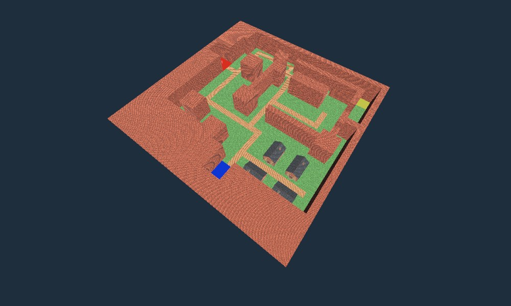
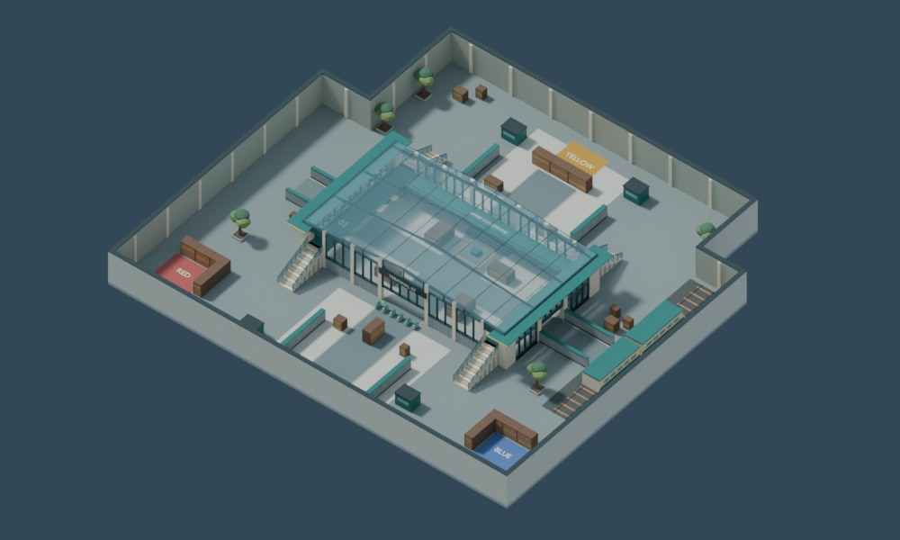

<!-- ゲームの定義から自動生成 -->

# マップ

[キット](kits.md) · [スキル](skills.md)

## アリーナ

**対応モード** チームデスマッチ、タクティブル

赤レンガの壁で区切られたマップです。木の通路や階段で高台を行き来できます。

## Terminal 03

**対応モード** チームデスマッチ、タクティブル

ガラス屋根のターミナルを中心に、両脇に広場があります。広場では木箱や低い壁を遮蔽物にできます。

